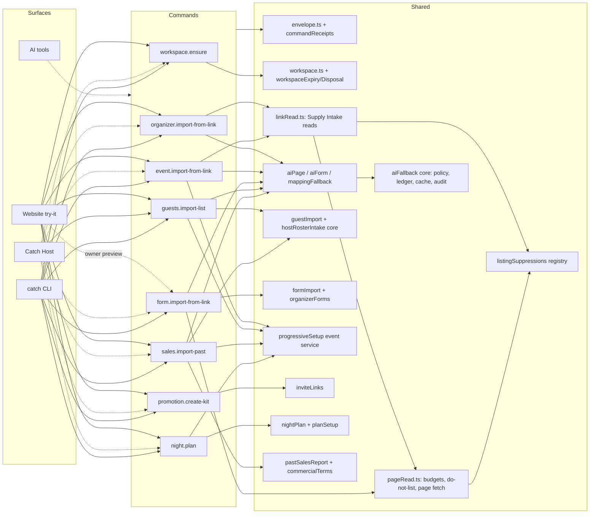

# Command Layer Map

Which surface calls which product command, which shared modules each command
stands on, and which older paths still repeat a command's job. The command
contract itself (envelope, receipts, effect classes) lives in
[Backend Operation Catalog](backend_operation_catalog.md#product-commands);
this page is the map reviewers check a change against.

## The rule

One capability has one backend implementation (owner decision, 18 Nov 2026;
issue #2058). A surface (website try-it, Catch Host, the `catch` CLI, AI
tools, later WhatsApp) calls the command listed in
`contracts/commands/catalog.json`. It never adds its own callable, parser,
page reader, AI client or write path for the same job. Shared plumbing lives
in one module each, listed below.

## Surfaces, commands and shared modules

Solid lines are live callers on main. Dashed lines are listed in the catalog
or built but not called yet.

## Live callers by command

The catalog lists `website`, `catch_host` and `cli` for every command; the
table records who calls each one on main.

| Command | Callable | Website try-it | Catch Host | `catch` CLI |
|---|---|---|---|---|
| `workspace.ensure` | `ensureTryItWorkspace` | yes | no (calls `createOrganizer`, which shares `stageOwnedOrganizerCreate`) | yes |
| `organizer.import-from-link` | `importOrganizerFromLink` | yes | no | yes |
| `event.import-from-link` | `importEventFromLink` | yes | no | yes |
| `form.import-from-link` | `importFormFromLink` | owner preview only, until the staging check passes | no | yes |
| `guests.import-list` | `importGuestList` | yes | preview only; revise and apply still go through `manageHostRosterIntake` | yes |
| `sales.import-past` | `importPastSales` | yes | no | yes |
| `promotion.create-kit` | `createPromotionKit` | yes | no (calls `createEventInviteLink`, which shares `inviteLinks`) | yes |
| `night.plan` | `planNight` | yes | no (calls `saveEventSuccessPlanSetup`, which shares `planSetup`) | yes |

AI tools (`operations/src/command-tools`) turn the catalog into tool
definitions; nothing outside their tests calls them yet. No WhatsApp path
calls a command yet.

## Shared modules: one each

| Concern | The one module | Notes |
|---|---|---|
| Envelope, replay, receipts | `functions/src/commands/envelope.ts` on `shared/commandReceipts.ts` | Apply reuses the preview's idempotency key. |
| Try-it workspace and expiry | `commands/workspace.ts`, `workspaceExpiry.ts`, `workspaceDisposal.ts` | 30 days after the last command. |
| Link reads through Supply Intake | `commands/linkRead.ts` | Organizer and event imports. |
| Link reads outside Supply Intake | `commands/pageRead.ts` | Form import, Luma claim check; budgets also spent by `linkRead.ts`. |
| Do-not-list | `listingSuppressions/registry.ts` | Checked before any read. |
| AI reads | `commands/aiFallback` (runner, ledger, policy) | Callers: `aiPage.ts`, `formImport/aiForm.ts`, `guestImport/mappingFallback.ts`. Off until switched on. |
| Guest rows | `guestImport/*` + `events/hostRosterIntakeCore` | Every guest file goes through one review session. |
| Event drafts | `events/progressiveSetup/service.ts` | Same path the Host app uses. |

## Known duplicates

Ranked by risk. Retire an old path only behind the seam: a deployed callable
stays until no supported app build calls it.

| What is done twice | Where | Plan | Status |
|---|---|---|---|
| Catch Host guest import split across two callables | `lib/contexts/audience/data/host_roster_intake_repository.dart`, `functions/src/events/hostRosterIntakeApply.ts` | App revise and apply move onto `guests.import-list`; the old callable stays for older builds | PR #2249 |
| Old instant-draft pipeline | `functions/src/instantDrafts/{request,status,materialize,expiry,publishOnClaim}.ts`, exported from `functions/src/index.ts` | Remove the two client-less callables, then drain existing requests before removing the trigger and expiry job; keep `links.ts` and `model.ts` | Open |
| Older app builds write `eventSuccessPlans` directly | `firestore.rules` (`match /eventSuccessPlans`) repeats `planSetup` checks | Close client create and update once older builds fall below the support floor | Needs support floor |
| Two Anthropic clients, four spend ledgers | `programs/assistant/provider.ts` and `budget.ts`; `aiFallbackUsage`; sales provider grants; `supplyIntakeUsage` | Move the assistant onto the operations provider with federation tokens; one reserve-then-settle ledger shape | Open |
| Host fee figures typed twice | `website/src/content/pricing.ts` vs `commercialTerms` used by `sales.import-past` | Generate the website figures from commercial terms, or check they match | Open |
| Structure defaults computed twice | `lib/contexts/formats/domain/event_success_structure.dart` and `functions/src/eventSuccess/nightPlan.ts` | App asks `night.plan` for a preview | Open |
| Guest rows without review | `importEventAttendees` still accepts file-format rows | Restrict to manual adds; files go through `guests.import-list` | Open |
| Client-less application import | `previewOrganizerApplicationImport`, `importOrganizerApplications` (own CSV mapping) | Delete, or route through the guest-import core | Open |

## Before adding a capability

1. Search the catalog and this map. If a command already does the job, call it.
2. If a surface needs something the command lacks, extend the command (a new
   input mode, an optional response field) rather than adding a callable.
3. New response fields are optional, so older clients keep validating.
4. Reads of outside pages go through `linkRead.ts` or `pageRead.ts`; AI reads
   go through the `aiFallback` core; guest rows go through the guest-import
   core.
5. Keep the catalog's `surfaces` truthful and update the tables above in the
   same PR.
