# Redesign Token Review Sheet

PR 1.1 of the redesign programme writes the system v15 values (blueprint D22)
into `design/tokens/catch.tokens.json`. That re-skins every screen not yet
redrawn, so it regenerates the goldens and Storybook baselines once. This sheet
is the review of that one regeneration. Issue #1462 tracks the work.

Before images come from `71a43d87f` and after images from
`523c3eb9c`.

## What moved

| Family | Before | After |
| --- | --- | --- |
| Colour | Page `#F4F4F1`, ink `#16140F`, status pigments | 34 system roles; older names alias them (see [Aliases](#aliases)) |
| Radius | xs 4, sm 8, md 14, lg 20, interactive tile 12 | xs 6, sm 10, md 16, lg 20, xl 24 |
| Button corner | 4px | 10px |
| Display type | 24, 30, 38, 48, 60, 72 | 24, 30, 38, 48, 64, 96 (older names read the new roles) |
| Labels | IBM Plex Mono, 9 to 12px, tracked | System sans, 12 to 13px, no tracking |
| Badge fills | The tone's own colour at 10 to 14% | `tint-*` under `deep-*` text |
| Shadow | card, raised, overlay | float, sheet, dialog |
| Motion | fast 120, micro 180, base 220, page step 280, slow 420 | instant 100, quick 160, standard 240, emphasized 360, slow 500 |
| Section gap | 24 | 28 (`section-gap-compact`) |
| Skeleton | `raised` under a `surface` shimmer | `tile` under a `ground` shimmer |

The platform type profiles in `typography.ios`, `.android` and `.web` keep
today's values, so body, title, control and field text does not change here.
P2.1 moves them when `CatchText` takes the system roles.

## How to read the tables

A script compared every changed image between the two commits.

- **Median pixels changed** is the share of pixels that moved by more than 2 of
  255 in any channel.
- **Size changed** counts images whose dimensions changed.
- **Kind of change** is a measured estimate. Every family lists colour, because
  the palette moved everywhere. It lists radius when the family's name is a
  component that reads the radius tokens. It lists type or spacing, with a count,
  for images whose size changed or whose edges moved by more than 4%. It can't
  tell type from spacing, but the only spacing token that moved is the section
  gap. The image pairs are the evidence; the kinds only point at what to look at.

## Where the plan and the system file differ

No number in §4 of the programme plan disagrees with the system file. These are
the places where this PR did something other than the plan's words, with the
reason.

| Plan says | This PR does | Why |
| --- | --- | --- |
| §4.2 lists "header row 56" under layout | Adds no token | The system file has no such token. It is `--bar-h` in the system's CSS, and `CatchLayout.topBarHeight` is already 56 |
| §4.2 renames `elevation.raised` to `sheet`, by order | `raised` aliases `float` | `sheet`'s shadow points up. The readers of `raised` are floating controls and popovers, and floating pills grew a grey band above them |
| §4.2 and D22 delete `interactiveTile` | Keeps the name as an alias of `radius.sm` | Code reads it: 9 CSS and 6 Dart reads. P7 deletes it |
| §4.1 deletes `primarySoft` | Keeps the name as an alias of `tile` | Code reads it. P7 deletes it |
| §4.2 says "map the rest" of the type roles | The platform profiles keep today's values | Moving them broke 15 tests, including 2 real overflows, and P2.1 moves them with `CatchText` |
| §4.1 maps `success` to mint and so on | `success`, `warning`, `danger` and `gold` alias `deep-*` | Readers use them as solid text and icon colours, and a tint would vanish. Badges read `tint-*` directly |
| §4.2 makes `gap.section` responsive | `gap.section` aliases `section-gap-compact` | `CatchGaps` is a constant. The responsive pair is on the tokens for P2 to read |

Two things to weigh in review:

- The system's own `.c-badge` draws `ink` text on its tints, while the token file
  says `deep-*` is the text on a tint. This PR uses `deep-*`, which keeps the tone
  readable as colour and clears AA on every pair (lowest 4.54:1). The Badge port
  can choose.
- IBM Plex Mono is gone from UI labels, but the font stays bundled and keeps its
  `@font-face`, because Admin's marketing image exports still name it.

## Aliases

147 deprecated tokens across 58 rows. P7 deletes them, and this table is the
list to grep.

`@Deprecated` is on the generated Dart for every row except these, where it would
fail `dart analyze --fatal-infos` in code this PR does not touch, so the mark is a
doc comment or `$description` only:

- the hand-written `CatchTokens` fields, which every screen reads
- the `CatchRadius`, `CatchGaps`, `CatchMotion`, `CatchElevation`, `CatchOpacity` and
  `CatchFieldTokens` constants
- `CatchTextStyles`

`packages/catch_tokens/analysis_options.yaml` turns off
`deprecated_member_use_from_same_package` so that the package's own wrappers can
read the generated aliases. P7 removes that line too. In CSS, a comment block marks
the aliases in each rule.

| Token | CSS | Dart | Resolves to |
| --- | --- | --- | --- |
| `theme.{light,dark}.color.bg` | `--catch-theme-bg`, `--catch-color-{light,dark}-bg` | `GeneratedCatchColorTokens.{light,dark}Bg`, `CatchTokens.bg` | `theme.{light,dark}.color.tile` |
| `theme.{light,dark}.color.surface` | `--catch-theme-surface`, `--catch-color-{light,dark}-surface` | `GeneratedCatchColorTokens.{light,dark}Surface`, `CatchTokens.surface` | `theme.{light,dark}.color.ground` |
| `theme.{light,dark}.color.raised` | `--catch-theme-raised`, `--catch-color-{light,dark}-raised` | `GeneratedCatchColorTokens.{light,dark}Raised`, `CatchTokens.raised` | `theme.{light,dark}.color.nested` |
| `theme.{light,dark}.color.overlay` | `--catch-theme-overlay`, `--catch-color-{light,dark}-overlay` | `GeneratedCatchColorTokens.{light,dark}Overlay`, `CatchTokens.overlay` | `theme.{light,dark}.color.scrim` |
| `theme.{light,dark}.color.line2` | `--catch-theme-line2`, `--catch-color-{light,dark}-line2` | `GeneratedCatchColorTokens.{light,dark}Line2`, `CatchTokens.line2` | `theme.{light,dark}.color.controlLine` |
| `theme.{light,dark}.color.primaryInk` | `--catch-theme-primary-ink`, `--catch-color-{light,dark}-primary-ink` | `GeneratedCatchColorTokens.{light,dark}PrimaryInk`, `CatchTokens.primaryInk` | `theme.{light,dark}.color.onPrimary` |
| `theme.{light,dark}.color.primarySoft` | `--catch-theme-primary-soft`, `--catch-color-{light,dark}-primary-soft` | `GeneratedCatchColorTokens.{light,dark}PrimarySoft`, `CatchTokens.primarySoft` | `theme.{light,dark}.color.tile` |
| `theme.{light,dark}.color.accent` | `--catch-theme-accent`, `--catch-color-{light,dark}-accent` | `GeneratedCatchColorTokens.{light,dark}Accent`, `CatchTokens.accent` | `theme.{light,dark}.color.primary` |
| `theme.{light,dark}.color.accentInk` | `--catch-theme-accent-ink`, `--catch-color-{light,dark}-accent-ink` | `GeneratedCatchColorTokens.{light,dark}AccentInk`, `CatchTokens.accentInk` | `theme.{light,dark}.color.onPrimary` |
| `theme.{light,dark}.color.success` | `--catch-theme-success`, `--catch-color-{light,dark}-success` | `GeneratedCatchColorTokens.{light,dark}Success`, `CatchTokens.success` | `theme.{light,dark}.color.deepMint` |
| `theme.{light,dark}.color.warning` | `--catch-theme-warning`, `--catch-color-{light,dark}-warning` | `GeneratedCatchColorTokens.{light,dark}Warning`, `CatchTokens.warning` | `theme.{light,dark}.color.deepYellow` |
| `theme.{light,dark}.color.danger` | `--catch-theme-danger`, `--catch-color-{light,dark}-danger` | `GeneratedCatchColorTokens.{light,dark}Danger`, `CatchTokens.danger` | `theme.{light,dark}.color.deepCoral` |
| `theme.{light,dark}.color.like` | `--catch-theme-like`, `--catch-color-{light,dark}-like` | `GeneratedCatchColorTokens.{light,dark}Like`, `CatchTokens.like` | `theme.{light,dark}.color.primary` |
| `theme.{light,dark}.color.pass` | `--catch-theme-pass`, `--catch-color-{light,dark}-pass` | `GeneratedCatchColorTokens.{light,dark}Pass`, `CatchTokens.pass` | `theme.{light,dark}.color.ink3` |
| `theme.{light,dark}.color.gold` | `--catch-theme-gold`, `--catch-color-{light,dark}-gold` | `GeneratedCatchColorTokens.{light,dark}Gold`, `CatchTokens.gold` | `theme.{light,dark}.color.deepYellow` |
| `theme.{light,dark}.color.positiveText` | `--catch-theme-positive-text`, `--catch-color-{light,dark}-positive-text` | `GeneratedCatchColorTokens.{light,dark}PositiveText`, `CatchTokens.positiveText` | `theme.{light,dark}.color.deepMint` |
| `theme.{light,dark}.color.attentionText` | `--catch-theme-attention-text`, `--catch-color-{light,dark}-attention-text` | `GeneratedCatchColorTokens.{light,dark}AttentionText`, `CatchTokens.attentionText` | `theme.{light,dark}.color.deepYellow` |
| `theme.{light,dark}.color.affinityText` | `--catch-theme-affinity-text`, `--catch-color-{light,dark}-affinity-text` | `GeneratedCatchColorTokens.{light,dark}AffinityText`, `CatchTokens.affinityText` | `theme.{light,dark}.color.deepPink` |
| `theme.{light,dark}.color.dangerText` | `--catch-theme-danger-text`, `--catch-color-{light,dark}-danger-text` | `GeneratedCatchColorTokens.{light,dark}DangerText`, `CatchTokens.dangerText` | `theme.{light,dark}.color.deepCoral` |
| `theme.{light,dark}.color.goldText` | `--catch-theme-gold-text`, `--catch-color-{light,dark}-gold-text` | `GeneratedCatchColorTokens.{light,dark}GoldText`, `CatchTokens.goldText` | `theme.{light,dark}.color.deepYellow` |
| `theme.{light,dark}.gradient.heroGrad` | None | `GeneratedCatchGradientTokens.{light,dark}HeroGrad`, `CatchTokens.heroGrad` | Nothing; derive from the activity pigment or ink |
| `gap.section` | `--catch-gap-section` | `GeneratedCatchGapTokens.section`, `CatchGaps.section` | `layout.sectionGapCompact` |
| `radius.interactiveTile` | `--catch-radius-interactive-tile` | `GeneratedCatchRadiusTokens.interactiveTile`, `CatchRadius.interactiveTile` | `radius.sm` |
| `opacity.controlOverlayHover` | `--catch-opacity-control-overlay-hover` | `GeneratedCatchOpacityTokens.controlOverlayHover`, `CatchOpacity.controlOverlayHover` | `opacity.hover` |
| `field.activeTintAlpha` | `--catch-field-active-tint-alpha` | `GeneratedCatchFieldTokens.activeTintAlpha`, `CatchFieldTokens.activeTintAlpha` | `opacity.hover` |
| `field.pressedTintAlpha` | `--catch-field-pressed-tint-alpha` | `GeneratedCatchFieldTokens.pressedTintAlpha`, `CatchFieldTokens.pressedTintAlpha` | `opacity.pressed` |
| `field.disabledOpacity` | `--catch-field-disabled-opacity` | `GeneratedCatchFieldTokens.disabledOpacity`, `CatchFieldTokens.disabledOpacity` | `opacity.disabled` |
| `font.family.data` | `--catch-font-data` | `GeneratedCatchFontFamilyTokens.data` | `font.family.function` |
| `font.family.mono` | `--catch-font-mono` | `GeneratedCatchFontFamilyTokens.mono` | `font.family.function` |
| `motion.fast` | `--catch-motion-fast` | `GeneratedCatchMotionTokens.fast`, `CatchMotion.fast` | `duration.instant` |
| `motion.micro` | `--catch-motion-micro` | `GeneratedCatchMotionTokens.micro`, `CatchMotion.micro` | `duration.quick` |
| `motion.chatScroll` | `--catch-motion-chat-scroll` | `GeneratedCatchMotionTokens.chatScroll`, `CatchMotion.chatScroll` | `duration.standard` |
| `motion.base` | `--catch-motion-base` | `GeneratedCatchMotionTokens.base`, `CatchMotion.base`, `CatchMotion.standard` | `duration.standard` |
| `motion.pageStep` | `--catch-motion-page-step` | `GeneratedCatchMotionTokens.pageStep`, `CatchMotion.pageStep` | `duration.emphasized` |
| `motion.calendarScroll` | `--catch-motion-calendar-scroll` | `GeneratedCatchMotionTokens.calendarScroll`, `CatchMotion.calendarScroll` | `duration.emphasized` |
| `motion.slow` | `--catch-motion-slow` | `GeneratedCatchMotionTokens.slow`, `CatchMotion.slow` | `duration.slow` |
| `motion.standardCurve` | `--catch-motion-standard-curve` | `GeneratedCatchMotionTokens.standardCurve`, `CatchMotion.standardCurve` | `easing.standard` |
| `motion.springCurve` | `--catch-motion-spring-curve` | `GeneratedCatchMotionTokens.springCurve`, `CatchMotion.springCurve` | `easing.spring` |
| `elevation.card` | `--catch-elevation-card` | `GeneratedCatchElevationTokens.card`, `CatchElevation.card` | `theme.light.elevation.float` |
| `elevation.raised` | `--catch-elevation-raised` | `GeneratedCatchElevationTokens.raised`, `CatchElevation.raised` | `theme.light.elevation.float` |
| `elevation.overlay` | `--catch-elevation-overlay` | `GeneratedCatchElevationTokens.overlay`, `CatchElevation.overlay` | `theme.light.elevation.dialog` |
| `typography.brand.displayXs.*` | `--catch-typography-brand-display-xs-{family,size,line-height,weight,tracking}` | `CatchTextStyles.displayXs` | `typography.role.displaySm` |
| `typography.brand.displayS.*` | `--catch-typography-brand-display-s-{family,size,line-height,weight,tracking}` | `CatchTextStyles.displayS` | `typography.role.displaySection` |
| `typography.brand.displayM.*` | `--catch-typography-brand-display-m-{family,size,line-height,weight,tracking}` | `CatchTextStyles.displayM` | `typography.role.displayTitle` |
| `typography.brand.displayL.*` | `--catch-typography-brand-display-l-{family,size,line-height,weight,tracking}` | `CatchTextStyles.displayL` | `typography.role.displayLg` |
| `typography.brand.displayXl.*` | `--catch-typography-brand-display-xl-{family,size,line-height,weight,tracking}` | `CatchTextStyles.displayXl` | `typography.role.displayXl` |
| `typography.brand.displayXxl.*` | `--catch-typography-brand-display-xxl-{family,size,line-height,weight,tracking}` | `CatchTextStyles.displayXxl` | `typography.role.displayHero` |
| `typography.brand.kicker.*` | `--catch-typography-brand-kicker-{family,size,line-height,weight,tracking}` | `CatchTextStyles.kicker` | `typography.role.labelKicker` |
| `typography.brand.kickerLg.*` | `--catch-typography-brand-kicker-lg-{family,size,line-height,weight,tracking}` | `CatchTextStyles.kickerLg` | `typography.role.labelKicker` |
| `typography.brand.fieldSectionKicker.*` | `--catch-typography-brand-field-section-kicker-{family,size,line-height,weight,tracking}` | `CatchTextStyles.fieldSectionKicker` | `typography.role.labelKicker` |
| `typography.brand.sectionCount.*` | `--catch-typography-brand-section-count-{family,size,line-height,weight,tracking}` | `CatchTextStyles.sectionCount` | `typography.role.labelBadge` |
| `typography.brand.monoLabel.*` | `--catch-typography-brand-mono-label-{family,size,line-height,weight,tracking}` | `CatchTextStyles.monoLabel` | `typography.role.labelKicker` |
| `typography.brand.monoCapsLabel.*` | `--catch-typography-brand-mono-caps-label-{family,size,line-height,weight,tracking}` | `CatchTextStyles.monoCapsLabel` | `typography.role.labelKicker` |
| `typography.brand.monoLabelS.*` | `--catch-typography-brand-mono-label-s-{family,size,line-height,weight,tracking}` | `CatchTextStyles.monoLabelS` | `typography.role.labelBadge` |
| `typography.brand.meta.*` | `--catch-typography-brand-meta-{family,size,line-height,weight,tracking}` | `CatchTextStyles.meta` | `typography.role.bodyMeta` |
| `typography.brand.badge.*` | `--catch-typography-brand-badge-{family,size,line-height,weight,tracking}` | `CatchTextStyles.badge` | `typography.role.labelBadge` |
| `typography.brand.badgeCaps.*` | `--catch-typography-brand-badge-caps-{family,size,line-height,weight,tracking}` | `CatchTextStyles.badgeCaps` | `typography.role.labelBadge` |
| `typography.brand.numericLarge.*` | `--catch-typography-brand-numeric-large-{family,size,line-height,weight,tracking}` | `CatchTextStyles.numericLarge` | `typography.role.titleRow` |

## Golden families

1412 of 1426 images changed across 118 families, with 982 changing size.

| Family | Images | Changed | Size changed | Median pixels changed | Kind of change |
| --- | ---: | ---: | ---: | ---: | --- |
| adaptive_tab_bar_android_chrome | 2 | 2 | 0 | 99.2% | colour, type or spacing (1) |
| adaptive_tab_bar_ios_chrome | 2 | 2 | 0 | 99.2% | colour, type or spacing (1) |
| avatar_family | 4 | 4 | 0 | 95.6% | colour, type or spacing (2) |
| badge_recipe_family | 4 | 4 | 0 | 98.4% | colour, radius, type or spacing (4) |
| banner_family | 4 | 4 | 0 | 98.3% | colour, radius, type or spacing (2) |
| bar_indicator_family | 4 | 4 | 0 | 97.3% | colour, type or spacing (3) |
| button_anatomy | 4 | 4 | 0 | 92.8% | colour, radius, type or spacing (4) |
| button_family | 4 | 4 | 0 | 93.6% | colour, radius, type or spacing (3) |
| catches_hub_active.png | 1 | 0 | 0 | 0.0% | none |
| code_input_family | 4 | 4 | 0 | 98.1% | colour, radius, type or spacing (4) |
| compact_action_family | 4 | 4 | 0 | 98.9% | colour, type or spacing (3) |
| corpus app shell catchnavigationbutton | 2 | 2 | 0 | 97.2% | colour, radius, type or spacing (2) |
| corpus club detail cards | 2 | 2 | 2 | 100.0% | colour, radius, type or spacing (2) |
| corpus club discovery cards | 6 | 6 | 6 | 100.0% | colour, radius, type or spacing (6) |
| corpus core adapters feedback | 20 | 20 | 20 | 100.0% | colour, type or spacing (20) |
| corpus core catalog actions | 4 | 4 | 4 | 100.0% | colour, radius, type or spacing (4) |
| corpus core catalog activity | 8 | 8 | 8 | 100.0% | colour, type or spacing (8) |
| corpus core catalog data | 16 | 16 | 16 | 100.0% | colour, type or spacing (16) |
| corpus core catalog event | 20 | 20 | 20 | 100.0% | colour, type or spacing (20) |
| corpus core catalog feedback | 56 | 56 | 56 | 100.0% | colour, type or spacing (56) |
| corpus core catalog grouping | 4 | 4 | 0 | 97.4% | colour |
| corpus core catalog inputs | 8 | 8 | 8 | 100.0% | colour, radius, type or spacing (8) |
| corpus core catalog layout | 36 | 36 | 36 | 100.0% | colour, type or spacing (36) |
| corpus core catalog loading | 24 | 24 | 20 | 100.0% | colour, radius, type or spacing (20) |
| corpus core catalog media | 12 | 12 | 12 | 100.0% | colour, type or spacing (12) |
| corpus core catalog menus | 12 | 12 | 12 | 100.0% | colour, radius, type or spacing (12) |
| corpus core catalog motion | 8 | 8 | 8 | 100.0% | colour, type or spacing (8) |
| corpus core catalog navigation | 32 | 32 | 32 | 100.0% | colour, type or spacing (32) |
| corpus core catalog sections | 16 | 16 | 16 | 100.0% | colour, radius, type or spacing (16) |
| corpus core catalog selection | 4 | 4 | 4 | 100.0% | colour, radius, type or spacing (4) |
| corpus core catalog sheets | 24 | 24 | 24 | 100.0% | colour, radius, type or spacing (24) |
| corpus core patterns form | 36 | 36 | 36 | 100.0% | colour, type or spacing (36) |
| corpus core patterns header | 4 | 4 | 4 | 100.0% | colour, type or spacing (4) |
| corpus core patterns notice | 4 | 4 | 4 | 100.0% | colour, radius, type or spacing (4) |
| corpus core patterns page | 12 | 12 | 12 | 100.0% | colour, type or spacing (12) |
| corpus core patterns section | 20 | 20 | 20 | 100.0% | colour, radius, type or spacing (20) |
| corpus core patterns sections | 4 | 4 | 4 | 100.0% | colour, radius, type or spacing (4) |
| corpus core patterns viewport | 42 | 42 | 32 | 100.0% | colour, type or spacing (37) |
| corpus core primitives actions | 24 | 24 | 16 | 100.0% | colour, radius, type or spacing (24) |
| corpus core primitives activity | 12 | 12 | 12 | 100.0% | colour, type or spacing (12) |
| corpus core primitives analytics | 20 | 20 | 8 | 99.6% | colour, type or spacing (20) |
| corpus core primitives content | 4 | 4 | 4 | 100.0% | colour, type or spacing (4) |
| corpus core primitives data | 28 | 28 | 20 | 100.0% | colour, type or spacing (28) |
| corpus core primitives dialogs | 8 | 8 | 0 | 94.2% | colour, radius, type or spacing (8) |
| corpus core primitives entity | 4 | 4 | 4 | 100.0% | colour, type or spacing (4) |
| corpus core primitives feedback | 26 | 26 | 22 | 100.0% | colour, type or spacing (25) |
| corpus core primitives field | 28 | 28 | 28 | 100.0% | colour, radius, type or spacing (28) |
| corpus core primitives fields | 28 | 28 | 24 | 100.0% | colour, radius, type or spacing (24) |
| corpus core primitives icon | 8 | 8 | 8 | 100.0% | colour, type or spacing (8) |
| corpus core primitives inputs | 136 | 132 (18 new) | 82 | 100.0% | colour, radius, type or spacing (132) |
| corpus core primitives layout | 38 | 38 | 34 | 100.0% | colour, type or spacing (37) |
| corpus core primitives lists | 4 | 4 | 4 | 100.0% | colour, type or spacing (4) |
| corpus core primitives loading | 16 | 16 | 16 | 100.0% | colour, radius, type or spacing (16) |
| corpus core primitives media | 36 | 32 | 32 | 100.0% | colour, type or spacing (32) |
| corpus core primitives menus | 20 | 20 | 20 | 100.0% | colour, radius, type or spacing (20) |
| corpus core primitives metadata | 4 | 4 | 4 | 100.0% | colour, type or spacing (4) |
| corpus core primitives motion | 12 | 12 | 12 | 100.0% | colour, type or spacing (12) |
| corpus core primitives navigation | 64 | 64 | 56 | 100.0% | colour, type or spacing (63) |
| corpus core primitives people | 20 | 20 | 20 | 100.0% | colour, type or spacing (20) |
| corpus core primitives product | 30 | 30 | 10 | 97.7% | colour, type or spacing (26) |
| corpus core primitives search | 4 | 4 | 4 | 100.0% | colour, type or spacing (4) |
| corpus core primitives sections | 70 | 70 | 28 | 99.5% | colour, radius, type or spacing (70) |
| corpus core primitives selection | 18 | 18 | 14 | 100.0% | colour, radius, type or spacing (17) |
| corpus core primitives sheets | 18 | 18 | 14 | 100.0% | colour, radius, type or spacing (18) |
| corpus core primitives status | 20 | 20 | 20 | 100.0% | colour, type or spacing (20) |
| corpus core primitives surfaces | 6 | 6 | 2 | 98.6% | colour, radius, type or spacing (5) |
| corpus core primitives typography | 12 | 10 | 6 | 100.0% | colour, type or spacing (10) |
| corpus events tiles catchbadge | 4 | 4 | 0 | 100.0% | colour, radius, type or spacing (4) |
| corpus events tiles catchclockindicator | 4 | 4 | 0 | 100.0% | colour, radius, type or spacing (4) |
| corpus explore controls catchchoicebutton | 2 | 2 | 2 | 100.0% | colour, radius, type or spacing (2) |
| corpus explore controls catchiconaction | 2 | 2 | 2 | 100.0% | colour, radius, type or spacing (2) |
| corpus explore sections catchbutton | 2 | 2 | 2 | 100.0% | colour, radius, type or spacing (2) |
| corpus explore sections catchemptystate | 2 | 2 | 2 | 100.0% | colour, radius, type or spacing (2) |
| corpus geometry system catchbutton | 4 | 4 | 0 | 90.0% | colour, radius, type or spacing (4) |
| corpus geometry system catchmenu | 4 | 4 | 0 | 97.6% | colour, radius, type or spacing (3) |
| corpus geometry system catchsection | 24 | 24 | 6 | 98.1% | colour, radius, type or spacing (24) |
| corpus geometry system catchsheet | 4 | 4 | 0 | 94.6% | colour, radius, type or spacing (3) |
| corpus geometry system catchtabbar | 4 | 4 | 0 | 97.1% | colour, type or spacing (2) |
| corpus geometry system catchtopbar | 4 | 4 | 0 | 96.5% | colour, type or spacing (4) |
| corpus mitives field protocols | 4 | 4 | 4 | 100.0% | colour, radius, type or spacing (4) |
| corpus oduct surfaces profiles | 2 | 2 | 0 | 81.2% | colour, radius, type or spacing (2) |
| corpus p1 product surfaces | 50 | 50 | 8 | 80.5% | colour, radius, type or spacing (50) |
| corpus p3 utility surfaces | 8 | 8 | 0 | 99.8% | colour, radius, type or spacing (8) |
| corpus product materials onboarding | 4 | 4 | 2 | 100.0% | colour, type or spacing (4) |
| corpus review gates field | 4 | 4 | 0 | 95.0% | colour, radius |
| corpus roduct surfaces matches | 2 | 2 | 0 | 99.9% | colour, radius, type or spacing (2) |
| corpus surfaces profiles inline | 2 | 2 | 0 | 99.9% | colour, radius, type or spacing (2) |
| create_event_success.png | 1 | 0 | 0 | 0.0% | none |
| design_system_sheet | 2 | 2 | 0 | 96.4% | colour, radius, type or spacing (2) |
| divider_family | 4 | 4 | 0 | 99.8% | colour, type or spacing (3) |
| entity_materials | 2 | 2 | 0 | 69.1% | colour, type or spacing (2) |
| header_family | 4 | 4 | 0 | 99.0% | colour, type or spacing (4) |
| host_event_manage.png | 1 | 0 | 0 | 0.0% | none |
| icon_tile_family | 4 | 4 | 0 | 98.9% | colour, radius, type or spacing (1) |
| media_overlay_family | 2 | 2 | 0 | 86.5% | colour, type or spacing (1) |
| menu_chrome_family_440 | 4 | 4 | 0 | 97.6% | colour, radius, type or spacing (4) |
| menu_chrome_family_840 | 4 | 4 | 0 | 98.6% | colour, radius, type or spacing (4) |
| metadata_row_family | 4 | 4 | 0 | 99.6% | colour, type or spacing (4) |
| metric_family | 4 | 4 | 0 | 99.4% | colour, type or spacing (4) |
| primitive_roles | 4 | 4 | 0 | 96.6% | colour |
| profile_redesign | 2 | 2 | 0 | 76.0% | colour, type or spacing (2) |
| profile_redesign_dense_long_content | 2 | 2 | 0 | 81.3% | colour, type or spacing (2) |
| profile_redesign_missing_photos_dynamic_type | 2 | 2 | 0 | 80.0% | colour, type or spacing (2) |
| profile_running_identity.png | 1 | 0 | 0 | 0.0% | none |
| program screens | 8 | 8 | 0 | 16.5% | colour, type or spacing (7) |
| reveal_viewport_family.forward | 2 | 2 | 0 | 99.6% | colour |
| reveal_viewport_family.reverse | 2 | 2 | 0 | 99.7% | colour |
| text_roles | 4 | 4 | 0 | 100.0% | colour, type or spacing (4) |
| theme_body_text | 2 | 2 | 0 | 99.6% | colour |
| toggle_input_family | 2 | 2 | 0 | 98.6% | colour, radius, type or spacing (2) |
| widgetbook bottom_sheet_grabber | 4 | 4 | 2 | 100.0% | colour, radius, type or spacing (4) |
| widgetbook control_shell | 4 | 4 | 2 | 100.0% | colour, radius, type or spacing (4) |
| widgetbook icon_tile | 4 | 4 | 2 | 100.0% | colour, radius, type or spacing (4) |
| widgetbook menu_row | 4 | 4 | 2 | 100.0% | colour, radius, type or spacing (4) |
| widgetbook meta_dot_row | 4 | 4 | 2 | 100.0% | colour, type or spacing (4) |
| widgetbook mono_label | 4 | 4 | 0 | 98.4% | colour, type or spacing (4) |
| widgetbook page_dots | 4 | 4 | 2 | 100.0% | colour, type or spacing (4) |
| widgetbook stat_column | 4 | 4 | 2 | 100.0% | colour, type or spacing (4) |

## Storybook surfaces

1490 of 1300 images changed. New and gone images are in the Changed column.

CI compares only the Linux baselines, so the macOS ones on main had fallen behind:
many showed older pages, some stories had none, and some images were for stories the
registry no longer lists. A macOS diff therefore mixes older page changes in with the
tokens, so the pairs below come from Linux. Read the Linux rows for the re-skin.

The Linux website and web-ui baselines were themselves last refreshed on 26 and 31
October, so their diffs also carry page changes from since then. Admin's are the
most current. New stories have no before image, so they have no pair.

| Family | Images | Changed | Size changed | Median pixels changed | Kind of change |
| --- | ---: | ---: | ---: | ---: | --- |
| admin darwin | 352 | 366 (52 new) (14 gone) | 0 | 5.6% | colour, type or spacing (329) |
| admin linux | 352 | 366 (52 new) (14 gone) | 0 | 2.4% | colour, type or spacing (230) |
| website darwin | 216 | 290 (116 new) (74 gone) | 0 | 100.0% | colour, type or spacing (280) |
| website linux | 216 | 292 (106 new) (76 gone) | 0 | 100.0% | colour, type or spacing (259) |
| webui darwin | 82 | 88 (66 new) (6 gone) | 0 | 100.0% | colour, type or spacing (80) |
| webui linux | 82 | 88 (66 new) (6 gone) | 0 | 100.0% | colour, type or spacing (80) |

## Before and after: goldens

### adaptive_tab_bar_android_chrome

| Image | Before | After |
| --- | --- | --- |
| `adaptive_tab_bar_android_chrome.dark.png` |  |  |
| `adaptive_tab_bar_android_chrome.light.png` |  |  |

### adaptive_tab_bar_ios_chrome

| Image | Before | After |
| --- | --- | --- |
| `adaptive_tab_bar_ios_chrome.dark.png` |  |  |
| `adaptive_tab_bar_ios_chrome.light.png` |  |  |

### avatar_family

| Image | Before | After |
| --- | --- | --- |
| `avatar_family.dark.png` | 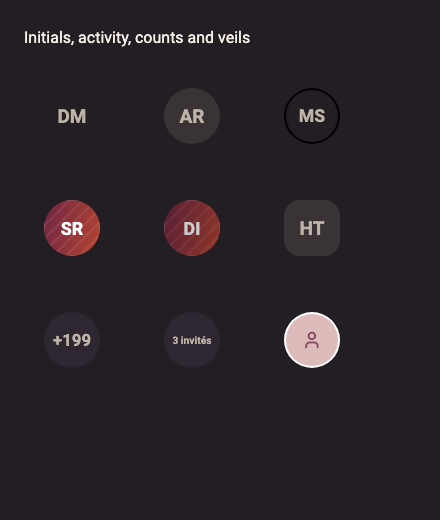 |  |
| `avatar_family@2.0.light.png` | 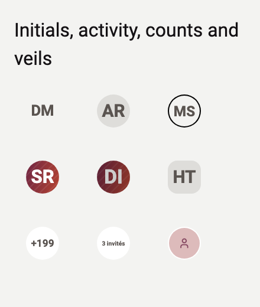 |  |
| `avatar_family.light.png` | 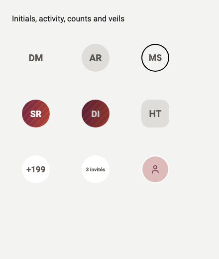 |  |

### badge_recipe_family

| Image | Before | After |
| --- | --- | --- |
| `badge_recipe_family@1.0.dark.png` |  |  |
| `badge_recipe_family@2.0.light.png` | 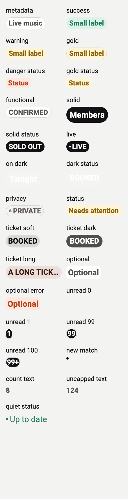 |  |
| `badge_recipe_family@1.0.light.png` | 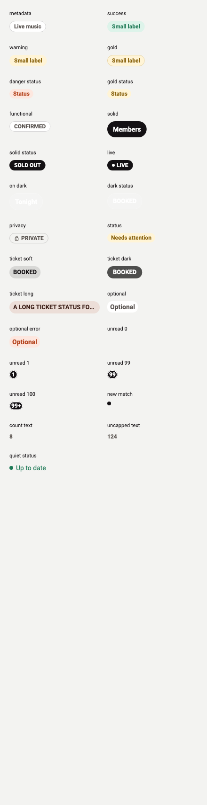 |  |

### banner_family

| Image | Before | After |
| --- | --- | --- |
| `banner_family.dark.png` |  |  |
| `banner_family@2.0.light.png` |  |  |
| `banner_family.light.png` |  |  |

### bar_indicator_family

| Image | Before | After |
| --- | --- | --- |
| `bar_indicator_family@1.0.dark.png` |  |  |
| `bar_indicator_family@2.0.light.png` |  |  |
| `bar_indicator_family@1.0.light.png` | 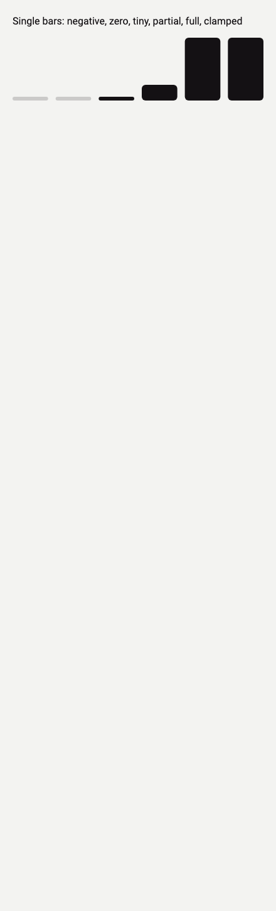 |  |

### button_anatomy

| Image | Before | After |
| --- | --- | --- |
| `button_anatomy@1.0.dark.png` |  |  |
| `button_anatomy@2.0.light.png` |  |  |
| `button_anatomy@1.0.light.png` |  |  |

### button_family

| Image | Before | After |
| --- | --- | --- |
| `button_family@1.0.dark.png` |  |  |
| `button_family@2.0.light.png` |  |  |
| `button_family@1.0.light.png` |  |  |

### code_input_family

| Image | Before | After |
| --- | --- | --- |
| `code_input_family.dark.png` |  |  |
| `code_input_family@2.0.light.png` | 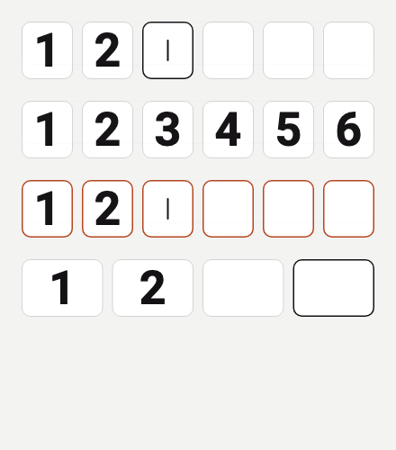 |  |
| `code_input_family.light.png` |  |  |

### compact_action_family

| Image | Before | After |
| --- | --- | --- |
| `compact_action_family@1.0.dark.png` |  |  |
| `compact_action_family@2.0.light.png` |  |  |
| `compact_action_family@1.0.light.png` |  |  |

### corpus app shell catchnavigationbutton

| Image | Before | After |
| --- | --- | --- |
| `app_shell_catchnavigationbutton_selected_destination_df9791ac.dark.png` |  |  |
| `app_shell_catchnavigationbutton_selected_destination_df9791ac.light.png` |  |  |

### corpus club detail cards

| Image | Before | After |
| --- | --- | --- |
| `club_detail_cards_catchmetarow_share_meta_row_states_9d7f1c90.dark.png` | 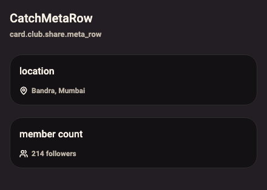 |  |
| `club_detail_cards_catchmetarow_share_meta_row_states_9d7f1c90.light.png` | 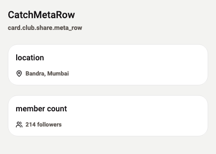 |  |

### corpus club discovery cards

| Image | Before | After |
| --- | --- | --- |
| `club_discovery_cards_catchposter_poster_states_1aef9ed8.dark.png` | 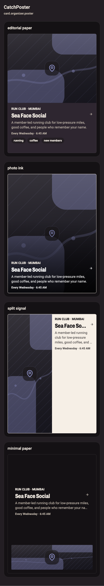 |  |
| `club_discovery_cards_catchposterheader_header_states_3c81e35d.light.png` | 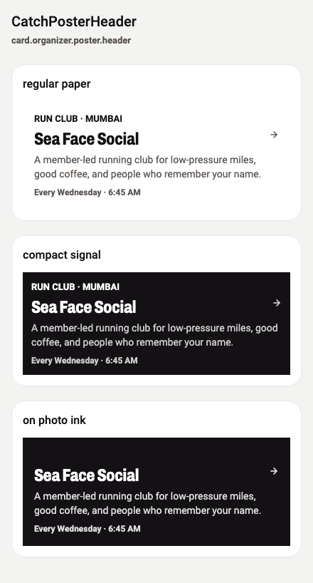 |  |
| `club_discovery_cards_catchposterimage_image_states_9a8fa149.light.png` | 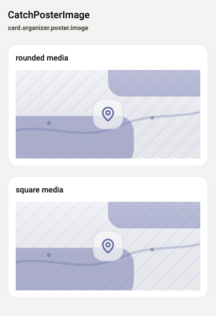 |  |

### corpus core adapters feedback

| Image | Before | After |
| --- | --- | --- |
| `core_adapters_feedback_catchlocalizederrorbanner_mapped_failures_and_retry_policy_9ba6f80d.dark.png` | 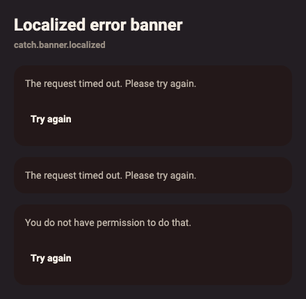 |  |
| `core_adapters_feedback_catchlocalizederrorstate_mapped_failures_and_explicit_recovery_2dc8912d@2.0.dark.png` |  |  |
| `core_adapters_feedback_catchlocalizedslivererrorstate_mapped_sliver_placements_51f7beb8@2.0.light.png` |  |  |

### corpus core catalog actions

| Image | Before | After |
| --- | --- | --- |
| `core_catalog_actions_catchbutton_text_states_d204fa15.dark.png` |  |  |
| `core_catalog_actions_catchbutton_text_states_d204fa15@2.0.dark.png` |  |  |
| `core_catalog_actions_catchbutton_text_states_d204fa15@2.0.light.png` | 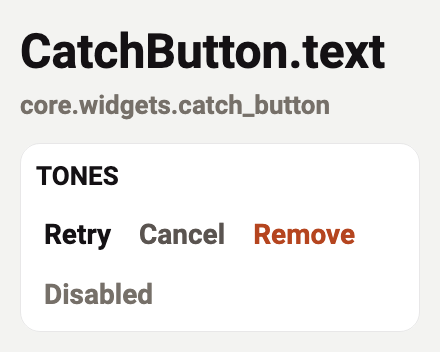 |  |

### corpus core catalog activity

| Image | Before | After |
| --- | --- | --- |
| `core_catalog_activity_activitymappin_catalog_states_2388302a.dark.png` | 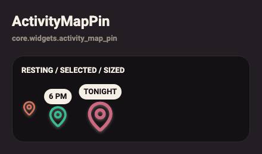 |  |
| `core_catalog_activity_catchdistanceoverlay_catalog_states_87b29f72.dark.png` | 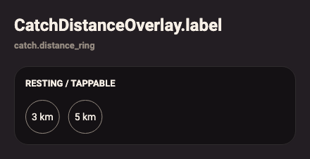 |  |
| `core_catalog_activity_catchdistanceoverlay_catalog_states_87b29f72@2.0.light.png` | 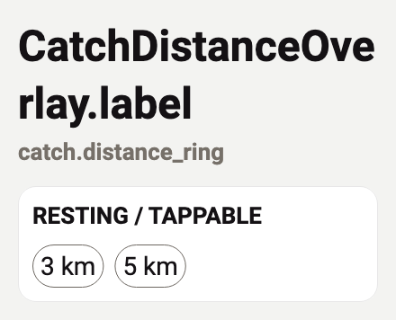 |  |

### corpus core catalog data

| Image | Before | After |
| --- | --- | --- |
| `core_catalog_data_display_catchmetarow_entry_states_8e7ad61a.dark.png` |  |  |
| `core_catalog_data_display_catchtablerow_catalog_states_9ca32f5a.dark.png` | 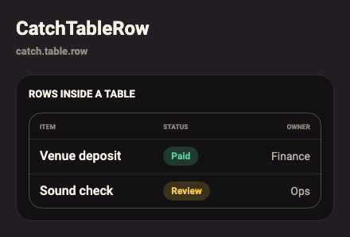 |  |
| `core_catalog_data_display_catchtablescope_catalog_states_2889dfba@2.0.light.png` | 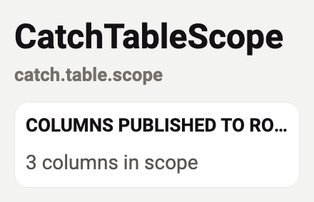 |  |

### corpus core catalog event

| Image | Before | After |
| --- | --- | --- |
| `core_catalog_event_cards_catchticketdivider_catalog_states_24aa201c.dark.png` | 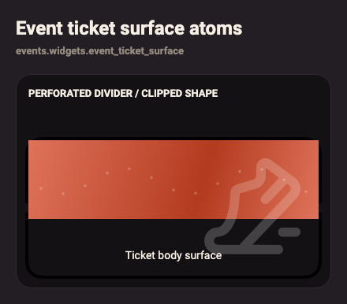 |  |
| `core_catalog_event_cards_eventbackdropimage_catalog_states_635072cd@2.0.dark.png` | 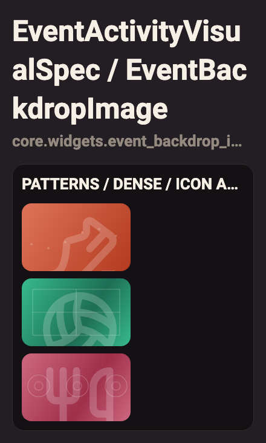 |  |
| `core_catalog_event_detail_catchpersonlayout_contact_states_bffb1f0b@2.0.light.png` | 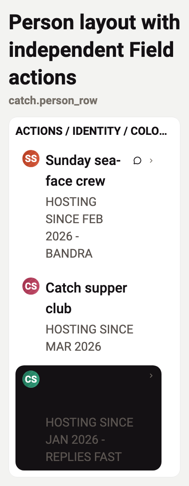 |  |

### corpus core catalog feedback

| Image | Before | After |
| --- | --- | --- |
| `core_catalog_feedback_catchbanner_catalog_states_3931a817.dark.png` |  |  |
| `core_catalog_feedback_catchlocalizederrorbanner_catalog_states_e58e8fb0.dark.png` | 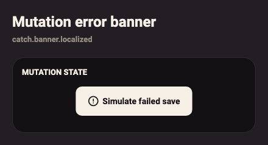 |  |
| `core_catalog_feedback_catchstateviewport_sliver_optical_center_4a2ce623@2.0.light.png` | 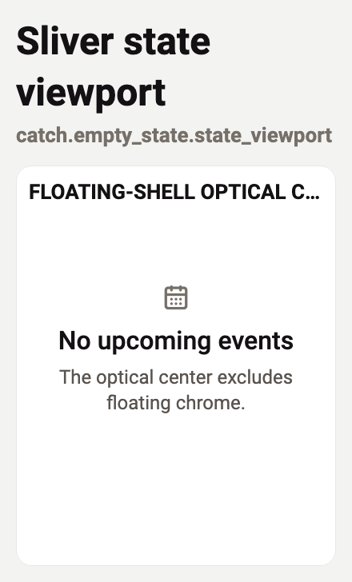 |  |

### corpus core catalog grouping

| Image | Before | After |
| --- | --- | --- |
| `core_catalog_grouping_catchdependentrowsection_dependent_configuration_91c5abfb.dark.png` |  |  |
| `core_catalog_grouping_catchdependentrowsection_dependent_configuration_91c5abfb@2.0.light.png` |  |  |
| `core_catalog_grouping_catchdependentrowsection_dependent_configuration_91c5abfb.light.png` |  |  |

### corpus core catalog inputs

| Image | Before | After |
| --- | --- | --- |
| `core_catalog_inputs_catchcodeinput_catalog_states_4e372128.dark.png` | 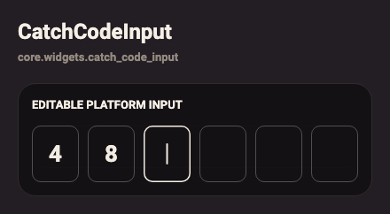 |  |
| `core_catalog_inputs_catchfieldlabeltext_catalog_states_3c9d4010.dark.png` | 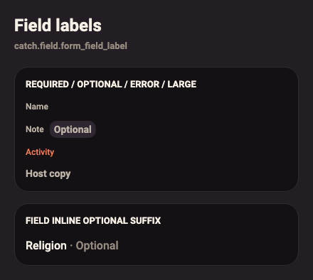 |  |
| `core_catalog_inputs_catchfieldlabeltext_catalog_states_3c9d4010@2.0.light.png` | 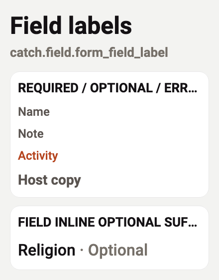 |  |

### corpus core catalog layout

| Image | Before | After |
| --- | --- | --- |
| `core_catalog_layout_catchdivider_catalog_states_9910739d.dark.png` | 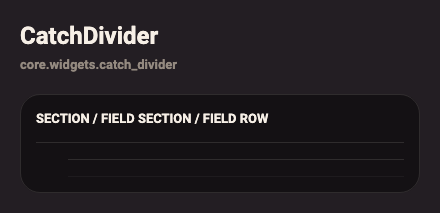 |  |
| `core_catalog_layout_catchpagebody_sliver_insets_af3073ef@2.0.dark.png` | 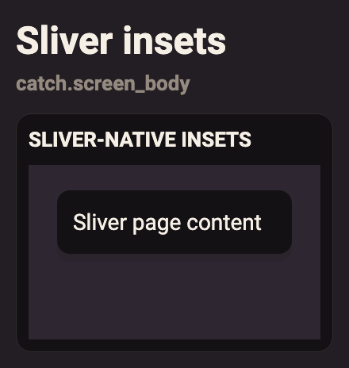 |  |
| `core_catalog_layout_catchviewport_local_sliver_geometry_1c6870b3@2.0.light.png` | 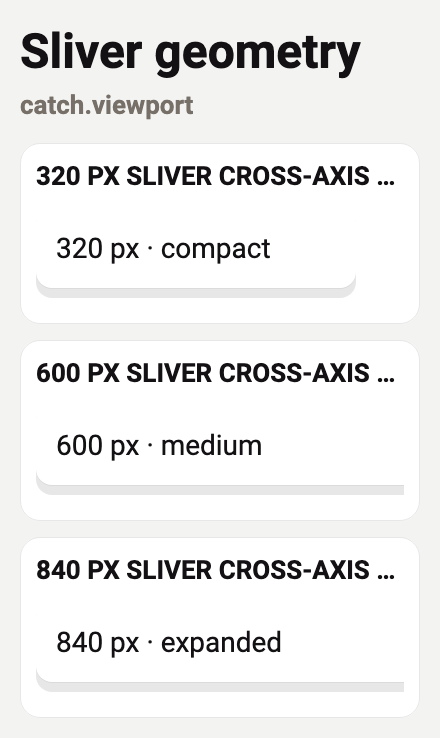 |  |

### corpus core catalog loading

| Image | Before | After |
| --- | --- | --- |
| `core_catalog_loading_catchasyncboundary_catalog_states_5a1156d2.dark.png` | 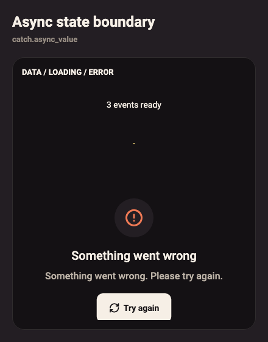 |  |
| `core_catalog_loading_splashscreen_catalog_states_62fec45a.dark.png` | 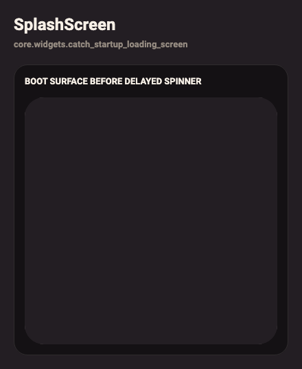 |  |
| `core_catalog_loading_compositions_catchskeleton_derived_content_a3ec8005.light.png` |  |  |

### corpus core catalog media

| Image | Before | After |
| --- | --- | --- |
| `core_catalog_media_catchgradedimage_catalog_states_d20e958a.dark.png` | 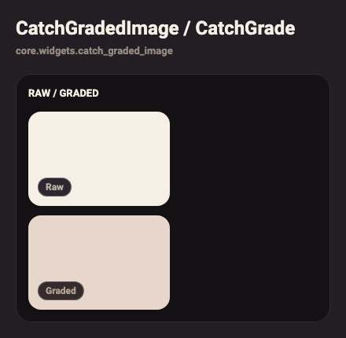 |  |
| `core_catalog_media_catchheroimage_catalog_states_3952110f@2.0.dark.png` |  |  |
| `core_catalog_media_eventthumbnail_catalog_states_9f26d6cf@2.0.light.png` |  |  |

### corpus core catalog menus

| Image | Before | After |
| --- | --- | --- |
| `core_catalog_menus_catchactionmenu_catalog_states_b0f953ef.dark.png` | 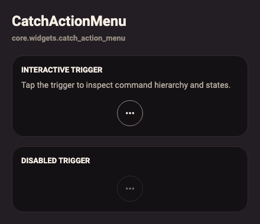 |  |
| `core_catalog_menus_catchmenu_catalog_states_97108ec9@2.0.dark.png` | 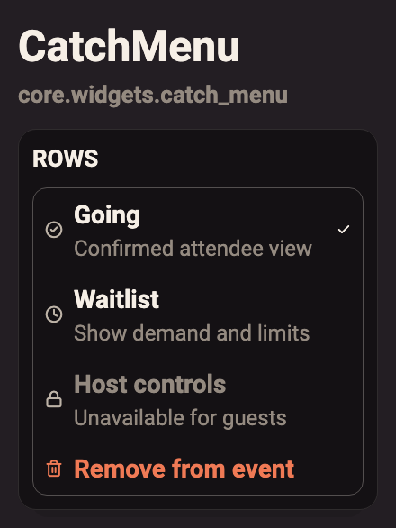 |  |
| `core_catalog_menus_catchselectionmenu_catalog_states_aa31e35b@2.0.light.png` | 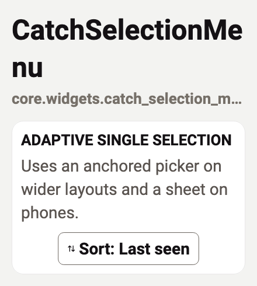 |  |

### corpus core catalog motion

| Image | Before | After |
| --- | --- | --- |
| `core_catalog_motion_catchheroviewport_catalog_states_b827226c.dark.png` |  |  |
| `core_catalog_motion_catchrevealviewport_catalog_states_15f849af.dark.png` | 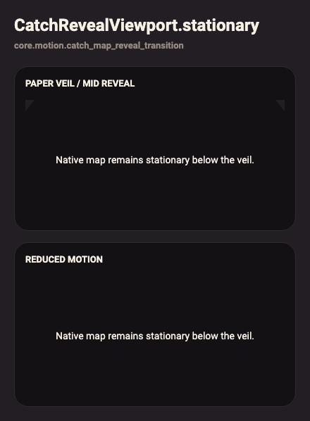 |  |
| `core_catalog_motion_catchrevealviewport_catalog_states_15f849af@2.0.light.png` | 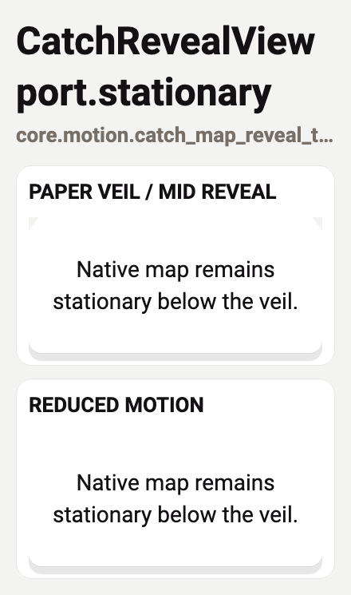 |  |

### corpus core catalog navigation

| Image | Before | After |
| --- | --- | --- |
| `core_catalog_navigation_catchactionmenu_toolbar_actions_ad6ed186.dark.png` |  |  |
| `core_catalog_navigation_catchsliverheader_catalog_states_6d811b5c.dark.png` | 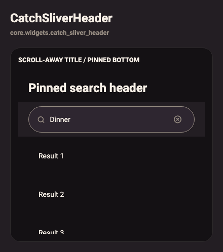 |  |
| `core_catalog_navigation_catchtopbarprimarybutton_catalog_states_f13bf464@2.0.light.png` | 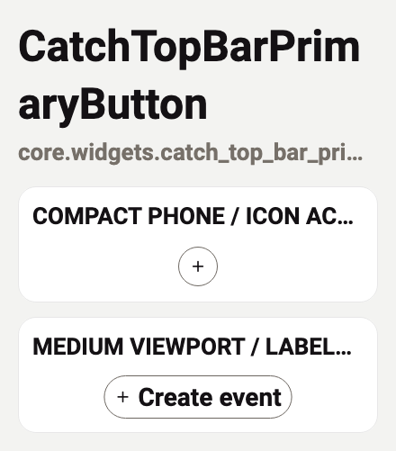 |  |

### corpus core catalog sections

| Image | Before | After |
| --- | --- | --- |
| `core_catalog_sections_catchcounttext_catalog_states_59f6d800.dark.png` | 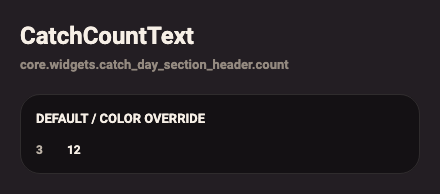 |  |
| `core_catalog_sections_catchsection_horizontal_collection_1d0d039e.dark.png` |  |  |
| `core_catalog_sections_catchsectionheader_catalog_states_f940e412@2.0.light.png` |  |  |

### corpus core catalog selection

| Image | Before | After |
| --- | --- | --- |
| `core_catalog_selection_catchchoiceinput_catalog_states_50fe2a2d.dark.png` | 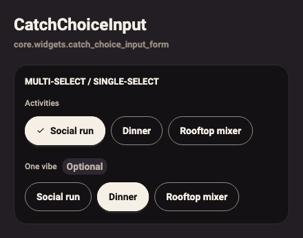 |  |
| `core_catalog_selection_catchchoiceinput_catalog_states_50fe2a2d@2.0.dark.png` | 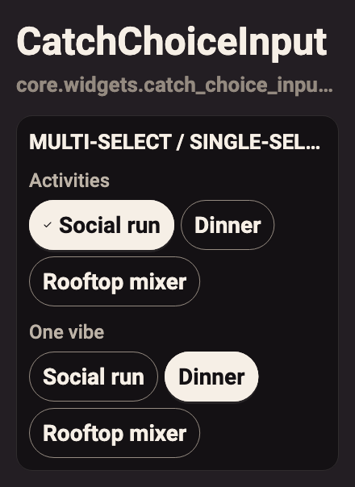 |  |
| `core_catalog_selection_catchchoiceinput_catalog_states_50fe2a2d@2.0.light.png` | 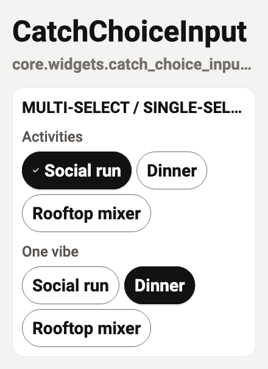 |  |

### corpus core catalog sheets

| Image | Before | After |
| --- | --- | --- |
| `core_catalog_sheets_and_footers_catchattributionrow_catalog_states_70e6771e.dark.png` | 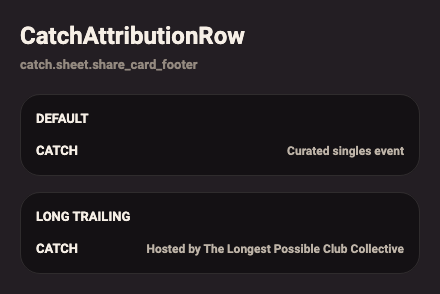 |  |
| `core_catalog_sheets_and_footers_catchdock_utility_states_3dcf7413.dark.png` | 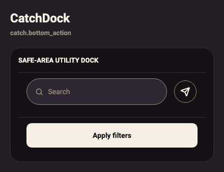 |  |
| `core_catalog_sheets_and_footers_catchsharecardsheet_sharing_state_b8678e95@2.0.light.png` |  |  |

### corpus core patterns form

| Image | Before | After |
| --- | --- | --- |
| `core_patterns_form_review_catchformreviewstate_incomplete_and_submission_ready_review_5134b36b.dark.png` |  |  |
| `core_patterns_form_rows_catchformlist_typed_rows_and_commit_modes_c81083ad@2.0.dark.png` | 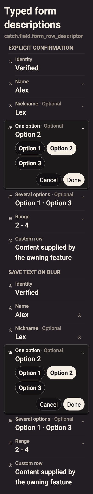 |  |
| `core_patterns_form_rows_catchformtextfield_typed_rows_and_commit_modes_44454062@2.0.light.png` | 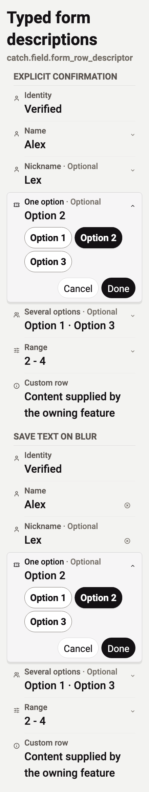 |  |

### corpus core patterns header

| Image | Before | After |
| --- | --- | --- |
| `core_patterns_header_sizing_catchscaledpreferredsize_direct_and_nested_scaled_header_reservation_948bc7ce.dark.png` |  |  |
| `core_patterns_header_sizing_catchscaledpreferredsize_direct_and_nested_scaled_header_reservation_948bc7ce@2.0.dark.png` |  |  |
| `core_patterns_header_sizing_catchscaledpreferredsize_direct_and_nested_scaled_header_reservation_948bc7ce@2.0.light.png` | 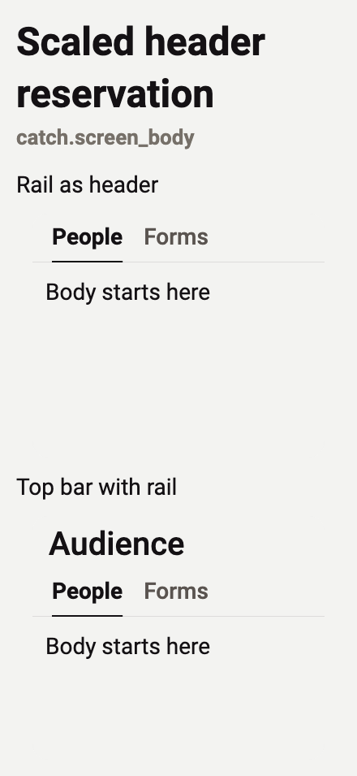 |  |

### corpus core patterns notice

| Image | Before | After |
| --- | --- | --- |
| `core_patterns_notice_provider_catchnoticecontrollerprovider_empty_and_published_notice_queue_2748507e.dark.png` | 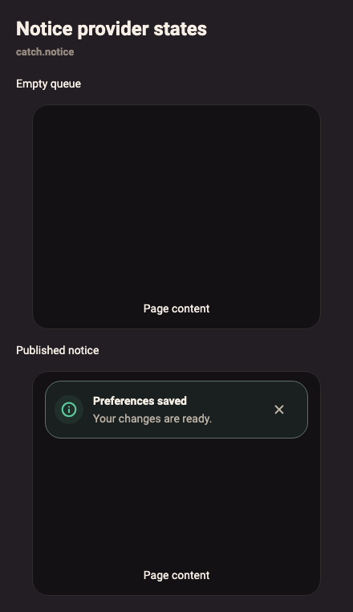 |  |
| `core_patterns_notice_provider_catchnoticecontrollerprovider_empty_and_published_notice_queue_2748507e@2.0.dark.png` |  |  |
| `core_patterns_notice_provider_catchnoticecontrollerprovider_empty_and_published_notice_queue_2748507e@2.0.light.png` |  |  |

### corpus core patterns page

| Image | Before | After |
| --- | --- | --- |
| `core_patterns_page_protocols_catchrootscreenbody_typed_pages_and_scroll_position_controller_60b5872f.dark.png` |  |  |
| `core_patterns_page_protocols_catchrootscreenscrollview_standard_full_bleed_and_pinned_rail_panes_5410948f@2.0.dark.png` |  |  |
| `core_patterns_page_protocols_catchroutescaffold_standard_and_full_bleed_route_bodies_b9b2790f@2.0.light.png` |  |  |

### corpus core patterns section

| Image | Before | After |
| --- | --- | --- |
| `core_patterns_section_layout_catchfieldinteractionplanescope_nested_body_paint_extents_5e1e7bc8.dark.png` |  |  |
| `core_patterns_section_layout_catchscrollterminalgap_extra_and_shell_aware_terminal_space_3a3c2e6d@2.0.dark.png` |  |  |
| `core_patterns_section_layout_catchsectionlist_scrolled_terminal_clearance_3ea287d1@2.0.light.png` |  |  |

### corpus core patterns sections

| Image | Before | After |
| --- | --- | --- |
| `core_patterns_sections_catchtimelinelist_contract_states_fed9fdb6.dark.png` |  |  |
| `core_patterns_sections_catchtimelinelist_contract_states_fed9fdb6@2.0.dark.png` |  |  |
| `core_patterns_sections_catchtimelinelist_contract_states_fed9fdb6@2.0.light.png` |  |  |

### corpus core patterns viewport

| Image | Before | After |
| --- | --- | --- |
| `core_patterns_viewport_catchbottomactionoverlay_scrolling_content_and_safe_areas_374c4ae6.dark.png` |  |  |
| `core_patterns_viewport_catchtabviewportscope_contract_states_addaf09c.light.png` |  |  |
| `core_patterns_viewport_catchworkspacepanescope_local_pane_presentation_f48c50a7.light.png` |  |  |

### corpus core primitives actions

| Image | Before | After |
| --- | --- | --- |
| `core_primitives_actions_catchbutton_floating_states_4906c773.dark.png` |  |  |
| `core_primitives_actions_catchloadingindicator_contract_states_05418232.dark.png` |  |  |
| `core_primitives_actions_catchbutton_contract_states_d0ca03eb.page-2.light.png` |  |  |

### corpus core primitives activity

| Image | Before | After |
| --- | --- | --- |
| `core_primitives_activity_activitymappin_contract_states_57ec9402.dark.png` |  |  |
| `core_primitives_activity_catchdistanceoverlay_contract_states_38d53666@2.0.dark.png` |  |  |
| `core_primitives_activity_catchdistanceoverlay_fixed_diameter_and_edge_label_3c21f40d@2.0.light.png` |  |  |

### corpus core primitives analytics

| Image | Before | After |
| --- | --- | --- |
| `core_primitives_analytics_kit_catchbanner_ready_partial_and_missing_data_fbfb76f5.dark.png` |  |  |
| `core_primitives_analytics_kit_catchdataqualitymetrictile_tile_states_ad51a1a1.dark.png` |  |  |
| `core_primitives_analytics_kit_catchdataqualitymetrictile_tile_states_ad51a1a1.light.png` |  |  |

### corpus core primitives content

| Image | Before | After |
| --- | --- | --- |
| `core_primitives_content_catchrecordlayout_contract_states_73c6c03a.dark.png` |  |  |
| `core_primitives_content_catchrecordlayout_contract_states_73c6c03a@2.0.dark.png` |  |  |
| `core_primitives_content_catchrecordlayout_contract_states_73c6c03a@2.0.light.png` |  |  |

### corpus core primitives data

| Image | Before | After |
| --- | --- | --- |
| `core_primitives_data_display_catchbarindicator_contract_states_9230815e.dark.png` |  |  |
| `core_primitives_data_display_catchtable_contract_states_2b86292e@2.0.dark.png` |  |  |
| `core_primitives_data_display_catchmetricsection_contract_states_49e25f7d.page-2.light.png` |  |  |

### corpus core primitives dialogs

| Image | Before | After |
| --- | --- | --- |
| `core_primitives_dialogs_catchdialog_contract_states_2a0cf72d.page-1.dark.png` |  |  |
| `core_primitives_dialogs_catchdialog_contract_states_2a0cf72d@2.0.page-1.light.png` |  |  |
| `core_primitives_dialogs_catchdialog_contract_states_2a0cf72d.page-2.light.png` |  |  |

### corpus core primitives entity

| Image | Before | After |
| --- | --- | --- |
| `core_primitives_entity_material_catchticket_contract_states_239a8aa0.dark.png` |  |  |
| `core_primitives_entity_material_catchticket_contract_states_239a8aa0@2.0.dark.png` |  |  |
| `core_primitives_entity_material_catchticket_contract_states_239a8aa0@2.0.light.png` |  |  |

### corpus core primitives feedback

| Image | Before | After |
| --- | --- | --- |
| `core_primitives_feedback_catchbanner_contract_states_a8bc5ec7.dark.png` |  |  |
| `core_primitives_feedback_catcherrorbackbutton_default_and_caller_owned_recovery_10c3d7ba.light.png` |  |  |
| `core_primitives_feedback_catcherrorstate_contract_states_b09750be@2.0.page-2.light.png` |  |  |

### corpus core primitives field

| Image | Before | After |
| --- | --- | --- |
| `core_primitives_field_protocols_catchaccordioncontroller_exclusive_field_disclosure_c1e20d70.dark.png` |  |  |
| `core_primitives_field_protocols_catchfieldinteractionplanescope_page_and_lane_paint_extents_c369b046@2.0.dark.png` |  |  |
| `core_primitives_field_protocols_catchformvalidationcopy_localized_constraint_messages_74d06561@2.0.light.png` |  |  |

### corpus core primitives fields

| Image | Before | After |
| --- | --- | --- |
| `core_primitives_fields_catchfieldchoicepickednotification_single_choice_disclosure_protocol_c6547c6c.dark.png` |  |  |
| `core_primitives_fields_catchfieldsurface_interaction_shapes_and_paint_states_988e1db7.dark.png` |  |  |
| `core_primitives_fields_catchfieldstatusindicator_saving_and_saved_682aac18@2.0.light.png` |  |  |

### corpus core primitives icon

| Image | Before | After |
| --- | --- | --- |
| `core_primitives_icon_atoms_catchicon_contract_states_453e6f30.dark.png` |  |  |
| `core_primitives_icon_atoms_catchicontile_contract_states_43c6000c.dark.png` |  |  |
| `core_primitives_icon_atoms_catchicontile_contract_states_43c6000c@2.0.light.png` |  |  |

### corpus core primitives inputs

| Image | Before | After |
| --- | --- | --- |
| `core_primitives_inputs_catchchoiceinput_contract_states_c9d32f1a.dark.png` |  |  |
| `core_primitives_inputs_catchrangeinput_contract_states_9b0f5c0c@2.0.light.png` |  |  |
| `core_primitives_inputs_catchchoiceinput_contract_states_c9d32f1a@2.0.page-2.light.png` |  |  |

### corpus core primitives layout

| Image | Before | After |
| --- | --- | --- |
| `core_primitives_layout_catchcontentsection_non_row_section_header_06610042.dark.png` |  |  |
| `core_primitives_layout_catchrail_contract_states_bca92b54@2.0.light.png` |  |  |
| `core_primitives_layout_catchviewport_contract_states_7f2774e2@2.0.page-2.light.png` |  |  |

### corpus core primitives lists

| Image | Before | After |
| --- | --- | --- |
| `core_primitives_lists_catchindexrow_contract_states_77beb38d.dark.png` |  |  |
| `core_primitives_lists_catchindexrow_contract_states_77beb38d@2.0.dark.png` |  |  |
| `core_primitives_lists_catchindexrow_contract_states_77beb38d@2.0.light.png` |  |  |

### corpus core primitives loading

| Image | Before | After |
| --- | --- | --- |
| `core_primitives_loading_catchasyncboundary_contract_states_a2f8a160.dark.png` |  |  |
| `core_primitives_loading_catchskeleton_contract_states_7e606b6f.dark.png` |  |  |
| `core_primitives_loading_splashscreen_contract_states_3a078e48@2.0.light.png` |  |  |

### corpus core primitives media

| Image | Before | After |
| --- | --- | --- |
| `core_primitives_media_catchgradedimage_contract_states_b5f10768.dark.png` |  |  |
| `core_primitives_media_catchnetworkimage_contract_states_577c4baf.dark.png` |  |  |
| `core_primitives_media_eventfallbackthumbnail_contract_states_a48d1fb1@2.0.light.png` |  |  |

### corpus core primitives menus

| Image | Before | After |
| --- | --- | --- |
| `core_primitives_menus_catchmenu_bottom_anchored_menu_8e989365.dark.png` |  |  |
| `core_primitives_menus_catchselectionmenu_custom_trigger_at_window_boundaries_2282685d@2.0.dark.png` |  |  |
| `core_primitives_menus_catchselectionsheet_selected_and_disabled_choices_9f6b6045@2.0.light.png` |  |  |

### corpus core primitives metadata

| Image | Before | After |
| --- | --- | --- |
| `core_primitives_metadata_catchmetarow_contract_states_4796ea14.dark.png` |  |  |
| `core_primitives_metadata_catchmetarow_contract_states_4796ea14@2.0.dark.png` |  |  |
| `core_primitives_metadata_catchmetarow_contract_states_4796ea14@2.0.light.png` |  |  |

### corpus core primitives motion

| Image | Before | After |
| --- | --- | --- |
| `core_primitives_motion_catchheroviewport_transparent_hero_material_997d20d1.dark.png` |  |  |
| `core_primitives_motion_catchrevealviewport_contract_states_4fc9ebdb@2.0.dark.png` |  |  |
| `core_primitives_motion_catchrevealviewport_resting_and_transition_poses_a46356f5@2.0.light.png` |  |  |

### corpus core primitives navigation

| Image | Before | After |
| --- | --- | --- |
| `core_primitives_navigation_catchcollapsedheadertitle_contract_states_51519982.dark.png` |  |  |
| `core_primitives_navigation_catchstepheader_contract_states_1cecf8cb.dark.png` |  |  |
| `core_primitives_navigation_catchtopbar_contract_states_ea40cf40@2.0.page-2.light.png` |  |  |

### corpus core primitives people

| Image | Before | After |
| --- | --- | --- |
| `core_primitives_people_catchavatar_contract_states_2927d08c.dark.png` |  |  |
| `core_primitives_people_catchavatarinitialssurface_contract_states_9429c47e@2.0.dark.png` |  |  |
| `core_primitives_people_catchavatarviewport_contract_states_5d887b1a@2.0.light.png` |  |  |

### corpus core primitives product

| Image | Before | After |
| --- | --- | --- |
| `core_primitives_product_composites_catchdock_contract_states_7d3b6394.dark.png` |  |  |
| `core_primitives_product_composites_catchpersonrowcopy_localized_conversation_copy_e4dd2f84@2.0.page-2.dark.png` |  |  |
| `core_primitives_product_composites_catchpersonrowcopy_localized_conversation_copy_e4dd2f84@2.0.page-2.light.png` |  |  |

### corpus core primitives search

| Image | Before | After |
| --- | --- | --- |
| `core_primitives_search_copy_catchsearchfieldcopy_default_and_overridden_search_copy_854ee955.dark.png` |  |  |
| `core_primitives_search_copy_catchsearchfieldcopy_default_and_overridden_search_copy_854ee955@2.0.dark.png` |  |  |
| `core_primitives_search_copy_catchsearchfieldcopy_default_and_overridden_search_copy_854ee955@2.0.light.png` |  |  |

### corpus core primitives sections

| Image | Before | After |
| --- | --- | --- |
| `core_primitives_sections_catchhorizontalscrollview_bounded_and_intrinsic_rails_fc7399c4.dark.png` |  |  |
| `core_primitives_sections_catchpagebody_contract_states_d55fb985.page-2.dark.png` |  |  |
| `core_primitives_sections_catchpagebody_contract_states_d55fb985.page-2.light.png` |  |  |

### corpus core primitives selection

| Image | Before | After |
| --- | --- | --- |
| `core_primitives_selection_catchchip_contract_states_a2ef0ee0.dark.png` |  |  |
| `core_primitives_selection_catchchoicetile_contract_states_d16aa2dd@2.0.light.png` |  |  |
| `core_primitives_selection_catchchip_contract_states_a2ef0ee0@2.0.page-2.light.png` |  |  |

### corpus core primitives sheets

| Image | Before | After |
| --- | --- | --- |
| `core_primitives_sheets_and_footers_catchsheet_contract_states_da525f40.dark.png` |  |  |
| `core_primitives_sheets_and_footers_catchsheetheader_plain_header_states_3a8fad1c@2.0.light.png` |  |  |
| `core_primitives_sheets_and_footers_catchsheet_contract_states_da525f40@2.0.page-2.light.png` |  |  |

### corpus core primitives status

| Image | Before | After |
| --- | --- | --- |
| `core_primitives_status_catchbadge_contract_states_108bf6b5.dark.png` |  |  |
| `core_primitives_status_catchprivacybadge_contract_states_ef5bbff3@2.0.dark.png` |  |  |
| `core_primitives_status_catchstatusrow_contract_states_e0d3de94@2.0.light.png` |  |  |

### corpus core primitives surfaces

| Image | Before | After |
| --- | --- | --- |
| `core_primitives_surfaces_catchsurface_contract_states_351a4c6f.dark.png` |  |  |
| `core_primitives_surfaces_catchsurface_contract_states_351a4c6f@2.0.page-2.dark.png` |  |  |
| `core_primitives_surfaces_catchsurface_contract_states_351a4c6f@2.0.page-2.light.png` |  |  |

### corpus core primitives typography

| Image | Before | After |
| --- | --- | --- |
| `core_primitives_typography_catchkickertext_contract_states_765fc5d9.dark.png` |  |  |
| `core_primitives_typography_catchtext_contract_states_f63ca744.light.png` |  |  |
| `core_primitives_typography_catchtext_contract_states_f63ca744@2.0.page-2.light.png` |  |  |

### corpus events tiles catchbadge

| Image | Before | After |
| --- | --- | --- |
| `events_tiles_catchbadge_visual_atom_status_cbb86f17.dark.png` |  |  |
| `events_tiles_catchbadge_visual_atom_status_cbb86f17@2.0.light.png` |  |  |
| `events_tiles_catchbadge_visual_atom_status_cbb86f17.light.png` |  |  |

### corpus events tiles catchclockindicator

| Image | Before | After |
| --- | --- | --- |
| `events_tiles_catchclockindicator_visual_atom_clock_89f87799.dark.png` |  |  |
| `events_tiles_catchclockindicator_visual_atom_clock_89f87799.light.png` |  |  |
| `events_tiles_catchclockindicator_visual_atom_clock_89f87799@2.0.light.png` |  |  |

### corpus explore controls catchchoicebutton

| Image | Before | After |
| --- | --- | --- |
| `explore_controls_catchchoicebutton_filter_option_item_states_b965f7f7.dark.png` |  |  |
| `explore_controls_catchchoicebutton_filter_option_item_states_b965f7f7.light.png` |  |  |

### corpus explore controls catchiconaction

| Image | Before | After |
| --- | --- | --- |
| `explore_controls_catchiconaction_counted_filter_action_7a4f5359.dark.png` |  |  |
| `explore_controls_catchiconaction_counted_filter_action_7a4f5359.light.png` |  |  |

### corpus explore sections catchbutton

| Image | Before | After |
| --- | --- | --- |
| `explore_sections_catchbutton_map_launcher_states_fd068c16.dark.png` |  |  |
| `explore_sections_catchbutton_map_launcher_states_fd068c16.light.png` |  |  |

### corpus explore sections catchemptystate

| Image | Before | After |
| --- | --- | --- |
| `explore_sections_catchemptystate_empty_states_177ac941.dark.png` |  |  |
| `explore_sections_catchemptystate_empty_states_177ac941.light.png` |  |  |

### corpus geometry system catchbutton

| Image | Before | After |
| --- | --- | --- |
| `geometry_system_catchbutton_geometry_matrix_d015d174@2.0.dark.png` |  |  |
| `geometry_system_catchbutton_geometry_matrix_d015d174@2.0.light.png` |  |  |
| `geometry_system_catchbutton_geometry_matrix_d015d174.light.png` |  |  |

### corpus geometry system catchmenu

| Image | Before | After |
| --- | --- | --- |
| `geometry_system_catchmenu_geometry_matrix_b375390b.dark.png` |  |  |
| `geometry_system_catchmenu_geometry_matrix_b375390b@2.0.light.png` |  |  |
| `geometry_system_catchmenu_geometry_matrix_b375390b.light.png` |  |  |

### corpus geometry system catchsection

| Image | Before | After |
| --- | --- | --- |
| `geometry_system_catchsection_create_event_modal_production_54eb58e9.dark.png` |  |  |
| `geometry_system_catchsection_responsive_page_contexts_0695b6ed@2.0.page-1.dark.png` |  |  |
| `geometry_system_catchsection_production_interaction_transitions_19860a59.light.png` |  |  |

### corpus geometry system catchsheet

| Image | Before | After |
| --- | --- | --- |
| `geometry_system_catchsheet_geometry_matrix_c4074cf3@2.0.dark.png` |  |  |
| `geometry_system_catchsheet_geometry_matrix_c4074cf3@2.0.light.png` |  |  |
| `geometry_system_catchsheet_geometry_matrix_c4074cf3.light.png` |  |  |

### corpus geometry system catchtabbar

| Image | Before | After |
| --- | --- | --- |
| `geometry_system_catchtabbar_geometry_matrix_90cf3b50.dark.png` |  |  |
| `geometry_system_catchtabbar_geometry_matrix_90cf3b50@2.0.light.png` |  |  |
| `geometry_system_catchtabbar_geometry_matrix_90cf3b50.light.png` |  |  |

### corpus geometry system catchtopbar

| Image | Before | After |
| --- | --- | --- |
| `geometry_system_catchtopbar_geometry_matrix_bc2ed654.dark.png` |  |  |
| `geometry_system_catchtopbar_geometry_matrix_bc2ed654@2.0.light.png` |  |  |
| `geometry_system_catchtopbar_geometry_matrix_bc2ed654.light.png` |  |  |

### corpus mitives field protocols

| Image | Before | After |
| --- | --- | --- |
| `mitives_field_protocols_catchresponsivefieldinteractionpolicy_compact_and_split_section_defaults_77e2db34.dark.png` |  |  |
| `mitives_field_protocols_catchresponsivefieldinteractionpolicy_compact_and_split_section_defaults_77e2db34@2.0.dark.png` |  |  |
| `mitives_field_protocols_catchresponsivefieldinteractionpolicy_compact_and_split_section_defaults_77e2db34@2.0.light.png` |  |  |

### corpus oduct surfaces profiles

| Image | Before | After |
| --- | --- | --- |
| `oduct_surfaces_profiles_inline_editors_catchchoiceinput_canonical_wrapping_choice_control_states_76ef70e8.dark.png` |  |  |
| `oduct_surfaces_profiles_inline_editors_catchchoiceinput_canonical_wrapping_choice_control_states_76ef70e8.light.png` |  |  |

### corpus p1 product surfaces

| Image | Before | After |
| --- | --- | --- |
| `p1_product_surfaces_event_success_host_live_components_catchpersonlayout_ready_c048588b.dark.png` |  |  |
| `p1_product_surfaces_catches_sections_catchpolaroid_person_polaroid_states_dcd17516.dark.png` |  |  |
| `p1_product_surfaces_user_analytics_catchmetrictile_inline_stat_states_4477683d.light.png` |  |  |

### corpus p3 utility surfaces

| Image | Before | After |
| --- | --- | --- |
| `p3_utility_surfaces_settings_catchpersonlayout_blocked_account_row_23a2f23b.dark.png` |  |  |
| `p3_utility_surfaces_image_uploads_orderedphotopicker_picker_states_6b0c8dff.light.png` |  |  |
| `p3_utility_surfaces_settings_catchpersonlayout_blocked_account_row_23a2f23b.light.png` |  |  |

### corpus product materials onboarding

| Image | Before | After |
| --- | --- | --- |
| `product_materials_onboarding_catchwelcometext_contract_states_d2eb4742.dark.png` |  |  |
| `product_materials_onboarding_catchwelcometext_contract_states_d2eb4742@2.0.dark.png` |  |  |
| `product_materials_onboarding_catchwelcometext_contract_states_d2eb4742@2.0.light.png` |  |  |

### corpus review gates field

| Image | Before | After |
| --- | --- | --- |
| `review_gates_field_motion_catchfield_approved_production_efdf4999.dark.png` |  |  |
| `review_gates_field_motion_catchfield_approved_production_efdf4999@2.0.light.png` |  |  |
| `review_gates_field_motion_catchfield_approved_production_efdf4999.light.png` |  |  |

### corpus roduct surfaces matches

| Image | Before | After |
| --- | --- | --- |
| `roduct_surfaces_matches_and_chat_primitives_catchtimestampedmessagetext_timestamped_message_text_a6ef5976.dark.png` |  |  |
| `roduct_surfaces_matches_and_chat_primitives_catchtimestampedmessagetext_timestamped_message_text_a6ef5976.light.png` |  |  |

### corpus surfaces profiles inline

| Image | Before | After |
| --- | --- | --- |
| `surfaces_profiles_inline_editors_catchformchoicefield_dynamic_dynamic_typed_descriptor_prototype_3ad7388b.dark.png` |  |  |
| `surfaces_profiles_inline_editors_catchformchoicefield_dynamic_dynamic_typed_descriptor_prototype_3ad7388b.light.png` |  |  |

### design_system_sheet

| Image | Before | After |
| --- | --- | --- |
| `design_system_sheet.dark.png` |  |  |
| `design_system_sheet.light.png` |  |  |

### divider_family

| Image | Before | After |
| --- | --- | --- |
| `divider_family@1.0.dark.png` |  |  |
| `divider_family@2.0.light.png` |  |  |
| `divider_family@1.0.light.png` |  |  |

### entity_materials

| Image | Before | After |
| --- | --- | --- |
| `entity_materials.dark.png` |  |  |
| `entity_materials.light.png` |  |  |

### header_family

| Image | Before | After |
| --- | --- | --- |
| `header_family@1.0.dark.png` |  |  |
| `header_family@2.0.light.png` |  |  |
| `header_family@1.0.light.png` |  |  |

### icon_tile_family

| Image | Before | After |
| --- | --- | --- |
| `icon_tile_family.dark.png` |  |  |
| `icon_tile_family@2.0.light.png` |  |  |
| `icon_tile_family.light.png` |  |  |

### media_overlay_family

| Image | Before | After |
| --- | --- | --- |
| `media_overlay_family.dark.png` |  |  |
| `media_overlay_family.light.png` |  |  |

### menu_chrome_family_440

| Image | Before | After |
| --- | --- | --- |
| `menu_chrome_family_440@1.0.dark.png` |  |  |
| `menu_chrome_family_440@2.0.light.png` |  |  |
| `menu_chrome_family_440@1.0.light.png` |  |  |

### menu_chrome_family_840

| Image | Before | After |
| --- | --- | --- |
| `menu_chrome_family_840@1.0.dark.png` |  |  |
| `menu_chrome_family_840@2.0.light.png` |  |  |
| `menu_chrome_family_840@1.0.light.png` |  |  |

### metadata_row_family

| Image | Before | After |
| --- | --- | --- |
| `metadata_row_family@1.0.dark.png` |  |  |
| `metadata_row_family@2.0.light.png` |  |  |
| `metadata_row_family@1.0.light.png` |  |  |

### metric_family

| Image | Before | After |
| --- | --- | --- |
| `metric_family@1.0.dark.png` |  |  |
| `metric_family@2.0.light.png` |  |  |
| `metric_family@1.0.light.png` |  |  |

### primitive_roles

| Image | Before | After |
| --- | --- | --- |
| `primitive_roles.dark.png` |  |  |
| `primitive_roles@2.0.light.png` |  |  |
| `primitive_roles.light.png` |  |  |

### profile_redesign

| Image | Before | After |
| --- | --- | --- |
| `profile_redesign.dark.png` |  |  |
| `profile_redesign.light.png` |  |  |

### profile_redesign_dense_long_content

| Image | Before | After |
| --- | --- | --- |
| `profile_redesign_dense_long_content.dark.png` |  |  |
| `profile_redesign_dense_long_content.light.png` |  |  |

### profile_redesign_missing_photos_dynamic_type

| Image | Before | After |
| --- | --- | --- |
| `profile_redesign_missing_photos_dynamic_type.dark.png` |  |  |
| `profile_redesign_missing_photos_dynamic_type.light.png` |  |  |

### program screens

| Image | Before | After |
| --- | --- | --- |
| `program_arrivals.png` |  |  |
| `program_dispatch.png` |  |  |
| `program_operations_review.png` |  |  |

### reveal_viewport_family.forward

| Image | Before | After |
| --- | --- | --- |
| `reveal_viewport_family.forward.dark.png` |  |  |
| `reveal_viewport_family.forward.light.png` |  |  |

### reveal_viewport_family.reverse

| Image | Before | After |
| --- | --- | --- |
| `reveal_viewport_family.reverse.dark.png` |  |  |
| `reveal_viewport_family.reverse.light.png` |  |  |

### text_roles

| Image | Before | After |
| --- | --- | --- |
| `text_roles.dark.png` |  |  |
| `text_roles@2.0.light.png` |  |  |
| `text_roles.light.png` |  |  |

### theme_body_text

| Image | Before | After |
| --- | --- | --- |
| `theme_body_text.dark.png` |  |  |
| `theme_body_text.light.png` |  |  |

### toggle_input_family

| Image | Before | After |
| --- | --- | --- |
| `toggle_input_family.dark.png` |  |  |
| `toggle_input_family.light.png` |  |  |

### widgetbook bottom_sheet_grabber

| Image | Before | After |
| --- | --- | --- |
| `bottom_sheet_grabber@2.0.dark.png` |  |  |
| `bottom_sheet_grabber.dark.png` |  |  |
| `bottom_sheet_grabber.light.png` |  |  |

### widgetbook control_shell

| Image | Before | After |
| --- | --- | --- |
| `control_shell@2.0.dark.png` |  |  |
| `control_shell.dark.png` |  |  |
| `control_shell.light.png` |  |  |

### widgetbook icon_tile

| Image | Before | After |
| --- | --- | --- |
| `icon_tile@2.0.dark.png` |  |  |
| `icon_tile.dark.png` |  |  |
| `icon_tile.light.png` |  |  |

### widgetbook menu_row

| Image | Before | After |
| --- | --- | --- |
| `menu_row@2.0.dark.png` |  |  |
| `menu_row.dark.png` |  |  |
| `menu_row.light.png` |  |  |

### widgetbook meta_dot_row

| Image | Before | After |
| --- | --- | --- |
| `meta_dot_row@2.0.dark.png` |  |  |
| `meta_dot_row.dark.png` |  |  |
| `meta_dot_row.light.png` |  |  |

### widgetbook mono_label

| Image | Before | After |
| --- | --- | --- |
| `mono_label.dark.png` |  |  |
| `mono_label@2.0.light.png` |  |  |
| `mono_label.light.png` |  |  |

### widgetbook page_dots

| Image | Before | After |
| --- | --- | --- |
| `page_dots@2.0.dark.png` |  |  |
| `page_dots.dark.png` |  |  |
| `page_dots.light.png` |  |  |

### widgetbook stat_column

| Image | Before | After |
| --- | --- | --- |
| `stat_column@2.0.dark.png` |  |  |
| `stat_column.dark.png` |  |  |
| `stat_column.light.png` |  |  |

## Before and after: Storybook

### admin linux

| Image | Before | After |
| --- | --- | --- |
| `admin-dashboard-routes--event-publishing-route-story.desktop.png` |  |  |
| `admin-dashboard-marketing-primitives--admin-marketing-composer-story.desktop.png` |  |  |
| `admin-dashboard-shared-primitives--admin-brand-mark-story.desktop.png` |  |  |

### website linux

| Image | Before | After |
| --- | --- | --- |
| `marketing-website-event-invitation--event-offer.mobile.png` |  |  |
| `marketing-website-public-paid-registration--booking-management.desktop.png` |  |  |
| `web-ui-event-thumbnail--photo.mobile.png` |  |  |

### webui linux

| Image | Before | After |
| --- | --- | --- |
| `web-ui-foundations--layout.mobile.png` |  |  |
| `web-ui-catchfield--contract.mobile.png` |  |  |
| `web-ui-primitives--toggle.mobile.png` |  |  |
